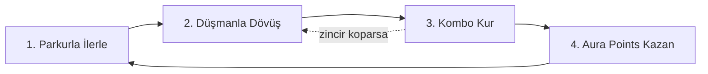

# Fever Dream: Game Design Document (çalışma kopyası)

> Bu dosya, ekibin paylaştığı GDD'nin (yazılı bölümler, tek sayfa özet, persona, kapak ve ilham panosu) proje içindeki
> çalışma kopyasıdır. Asıl kaynak ekibin GDD'sidir; burada yalnızca prototip için gereken bilgi toplanır.
> Bölümler GDD'de yazıldıkça burası da güncellenir.

## Durum

| Bölüm | Durum |
| --- | --- |
| 1.0 Executive Summary | Yazıldı |
| 2.0 Game Vision | Yazıldı (bu kopyada tek sayfa özetteki vizyon kullanıldı) |
| 3.0 Game Mechanics & Systems | Bekliyor |
| 4.0 Progression Systems | Bekliyor |
| 5.0 Alter Ego | Bekliyor |
| 6.0 Narrative & Characters | Bekliyor |
| 7.0 World & Level Design | Bekliyor |
| 8.0 Art Direction | Bekliyor |
| 9.0 Audio & Voice | Bekliyor |
| 10.0 UI/UX Design | Bekliyor |
| 11.0 Production Scope | Bekliyor |

## 1.2 Game Overview

Fever Dream, tek oyunculu, **birinci şahıs** bakış açılı bir **3D parkur + hack-and-slash** oyunudur. Absürt komedi tonundadır.

Oyuncu, anime seven bir üniversite öğrencisi olan **Jack Miller'ı** (20) kontrol eder. Jack bir rüyada uyanır ve tuvalet
aramaya başlar. Rüya, Jack'in bilinçaltından kurulu bir dünyadır: gündelik hayattan alınmış ama absürt ölçeklere taşınmış
eşyalar (devasa buzdolapları, çamaşır makineleri, alışveriş arabaları) ve Jack'in palyaço korkusuna gönderme yapan motifler.
Düşmanlar da aynı mantıkla tasarlanmıştır: alarm saatli ofis çalışanları ve klozet kapağını kalkan olarak kullanan düşmanlar.

Temel oynanış iki katmandır: **akıcı parkur** (duvarda koşma, kenara tutunma, Zincirli Kama ile çekilme) ve **kombo odaklı
yakın dövüş**. Oyuncu, şekil değiştiren silahı **Tsunagi** ile dövüşür. Skor yoktur; kombolar **Aura Points'e** dönüşür ve
Aura Points oyunun ana para birimidir.

Jack'in **alter ego'su** (roketli uçan diskin üzerinde, güneş gözlüklü, sarkastik bir güvercin kafası) oynanışı etkilemez.
Yalnızca ses ve komedi üzerinden dövüşe ve kazanılan Aura Points'e tepki verir. Finalde Jack alter ego'ya dönüşür.

Oyun, 5 lineer bölümden oluşan kısa bir indie yapımdır (tahmini 2-3 saat).

## 1.3 Game Card

| Alan | Değer |
| --- | --- |
| Oyun Adı | Fever Dream |
| Tür | Tek oyunculu, absürt komedi 3D parkur / hack-and-slash |
| Platform | PC |
| Engine | Unity |
| Perspektif | 3D, birinci şahıs |
| Yapı | 5 lineer bölüm, tahmini 2-3 saat |
| Ana Para Birimi | Aura Points |
| Hedef Yaş | 15-30 |

## 1.4 Core & Gameplay Loop

### Core Loop

1. **Parkurla ilerle:** Duvarda koşma, kenara tutunma; Zincirli Kama açıldıktan sonra kanca ile çekilme. Parkur, oyuncuyu
   dövüş alanlarına taşıyan geçiş katmanıdır.
2. **Düşmanla dövüş:** Ortamdan çıkan absürt düşmanlar. Her düşman tipi kendi zayıf noktasıyla gelir.
3. **Kombo kur:** Kesintisiz saldırılarla kombo zinciri. Zincir sürdükçe büyür, kopunca biter.
4. **Aura Points kazan:** Kombo bittiğinde biriken Aura Points toplu verilir. Hasar alınırsa veya boşluğa düşülürse
   kombo sıfırlanır ve puan verilmez.

### Gameplay Loop

Bölüme gir → core loop → Aura Points birikir → kontrol noktasında harca (yeni kombo, Tsunagi özelliği, can/eşya,
parkur yeteneği) → güçlenmiş Jack → sonraki bölüm. Bayonetta'daki kombo satın alma yapısından esinlenmiştir.

**Kurallar**
- Aura Points yalnızca dövüşteki kombolardan kazanılır, parkur Aura vermez.
- Aura Points kombo bitince toplu verilir; hasar veya boşluğa düşme komboyu sıfırlar, puan verilmez.
- Harcama alanları: yeni kombolar, Tsunagi özellikleri, can ve eşya yükseltmeleri, parkur yetenekleri.
- Skor veya puan tablosu yoktur. Harcama yalnızca kontrol noktalarında yapılır.

## Tek sayfa özetten (vizyon ve prototip kapsamı)

**Logline:** Absürt bir tuvalet arayışında, parkur ve kombo odaklı dövüşle güçlenen oyuncu, farkında olmadan kendi alter
egosunu yok eder ve finalde ona dönüşür.

**Core loop (6 adım):** Hareket (sprint, kayma, duvar koşusu, duvardan sıçrama, tırmanma) → Giriş (momentumu koruyarak
arenaya dal) → Dövüş (kombo, son an kaçınma, havaya fırlatma, havada kombo, bitirici) → Aura (stil kazandırır, kombolar ve
efektler gelişir) → Bedel (Aura arttıkça alter ego zayıflar, alayları paniğe döner) → Çıkış (parkurla arenadan çık).

**Vizyon**
- Ne kadar akıcı ve yaratıcı oynarsan o kadar ödüllenirsin. Sadece öldürmek yetmez, nasıl öldürdüğün önemlidir.
- Komedi dekor olarak kalmaz: tuvalet arayışı absürt motivasyonu verir, Aura sistemi komediyi oynanışa bağlar.
- Referanslar: Bayonetta (ritim ve kombo), hızlı 3D parkur oyunları (momentum ve akış). Amaç kopyalamak değil, kendi
  kimliğini kurmak.

**Prototip kapsamı:** Tek küçük seviye · 3 düşman tipi · temel kombo sistemi · Aura'ya bağlı alter ego tepkisi.

**Kanıtlanacak şey:** Parkur ve dövüş akıcı biçimde birleşiyor mu?

**Açık sorular (GDD'den)**
- Aura nasıl ölçülüyor (kombo çeşitliliği, süre, hasar almama)?
- Alter ego sadece ses ve metin mi, yoksa oynanışı da etkiliyor mu?
- Rüya dünyası prototipten sonra mı geliyor?

## Karakter: Jack Miller (persona)

- 20 yaşında, insan, üniversite öğrencisi; anime ve oyun bağımlısı. Anahtar kelimeler: Nerd, Sabırsız, Hayalperest.
- Yaşadığı evren: gündelik kampüs ve yurt hayatı; oyun boyunca rüya dünyası (Void).
- Arzu: bir tuvalet bulmak. Altında, anime kahramanı gibi gösterişli ve efsanevi biri olma isteği.
- Korku: sıradan ve fark edilmeyen biri olarak kalmak. Aura'yla "kahramanlaştıkça" iç sesini (alter egosunu) kaybeder.
- İkonik replik: "Magnezyum takviyesini doktor kontrolünde kullanınız."
- Yanında: sırt çantası (manga, enerji içeceği), kulaklık.

## Silah: Tsunagi (Bağlayıcı)

Rüya dünyasında bulunan, şekil değiştiren tek saplı silah. Kombo ilerledikçe 4 forma döner:

| Form | Rol |
| --- | --- |
| Katana | Hızlı vuruşlar, karşı saldırı |
| Zincirli Kama | Havaya fırlatma, parkurda kanca |
| Orak | Geniş alan, havada kombo |
| Devasa Kılıç | Ağır bitirici, Aura patlaması |

Formlar arası geçiş kesilmezse Aura bonusu artar.

## Kapak brief'i

Anime seven üniversite öğrencisi Jack, rüyasında tuvalet arar. Bilinçaltı gündelik ama absürt eşyalarla ve palyaço
korkusuyla dolu. Parkurla ilerle, Tsunagi ile dövüş, kombolarını Aura Points'e çevir. Sarkastik güvercin alter egon da
her hamleni yorumlasın.

## İlham panosu (notlar)

Palyaço figürleri ve palyaço korkusu, alaturka tuvalet, gözlü kupa ve gülen surat (absürt gündelik eşyalar), Resident
Evil / Metal Gear karakter alıntıları, "Aura Farmer" uçan disk üstündeki karakterler (alter ego), Mirror's Edge benzeri
birinci şahıs parkur, neon renkli kombo/aksiyon sahneleri, mor-camgöbeği rüya paleti.

## Belgeler arası farklar ve verilen kararlar

| Konu | Belgelerde | Karar |
| --- | --- | --- |
| Kamera | Yazılı GDD: birinci şahıs. Tek sayfa özet ve kapak: üçüncü şahıs | **Birinci şahıs** (proje sahibi kararı) |
| Aura | Yazılı GDD: para birimi, kombo bitince toplu. Özet: stil göstergesi, alter ego bedeli | Para birimi olarak işler; alter ego tepkisi toplam Aura'ya göre tonunu değiştirir |
| Alter ego etkisi | Yazılı GDD: oynanışı etkilemez | Prototipte yalnızca metin (altyazı) tepkisi |

Prototip kararlarının tamamı için bkz. `Docs/PROTOTYPE_PLAN.md`.
